<picture>
  <source media="(prefers-color-scheme: dark)" srcset="docs/screenshots/hero-dark.webp">
  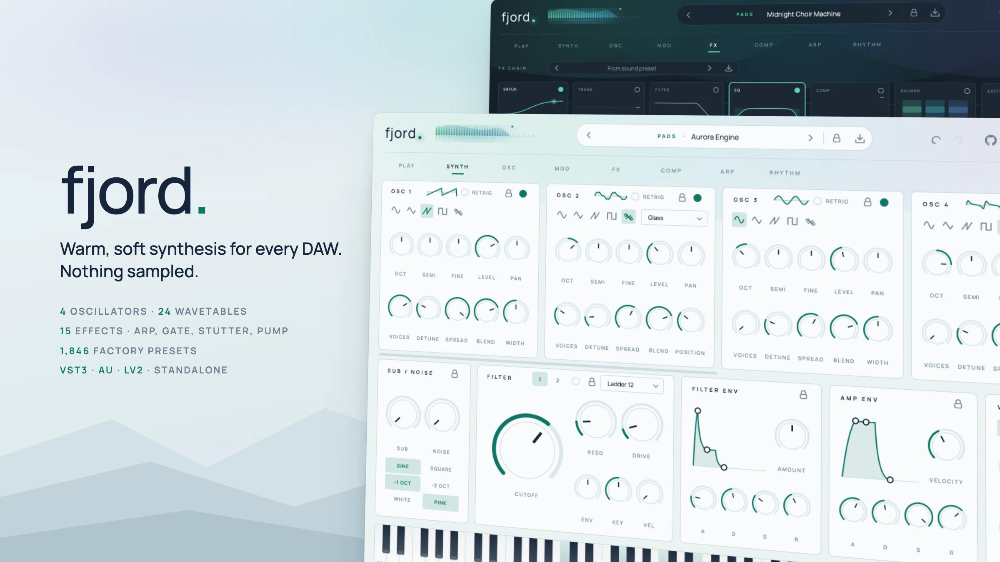
</picture>

# Fjord

A software synthesizer for every common DAW – VST3, Audio Unit, LV2 and a standalone app – with a warm,
soft sound, a Scandinavian minimalist interface (light/dark) and over 1,800 factory presets.
Every sound is synthesized in real time – there are no samples.

[](https://github.com/fjord-sounds/fjord/actions/workflows/ci.yml)
[](https://github.com/fjord-sounds/fjord/releases)
[](LICENSE)

> **Made with AI.** Fjord – the plugin code, the user interface, the tests and all factory presets – was written
> entirely by AI ("vibe coded") with Claude Opus, directed by prompts. Nothing is hand-programmed or hand-tuned.
> The code is open so you can read it, test it and judge for yourself; bug reports and pull requests are welcome.

## Lightweight

- **Small**: the VST3 is about 12 MB (macOS universal binary, arm64 + x86_64), including 1,800+ factory presets and the font.
- **Self-contained**: no sample library, no extra files to install, no installer data, no account, no network access.
  Presets and the font are compiled into the plugin.
- **Calm on the audio thread**: no allocations or locks while rendering sound.

<p>
  <a href="#listen">Listen</a> ·
  <a href="#works-in-your-daw">DAWs</a> ·
  <a href="#building">Building</a> ·
  <a href="#a-tour">Tour</a> ·
  <a href="#presets">Presets</a> ·
  <a href="https://github.com/fjord-sounds/fjord">GitHub</a>
</p>

## Listen

Short sketches in A minor (112 BPM), played with factory presets exactly as they ship – no extra processing
besides loudness matching. Click a title to play it in the browser.

| | Preset | What you hear |
|---|---|---|
| ▶ | [**Velvet Galaxy**](docs/audio/pad.mp3?raw=true) · Pad | slow chords, wide and soft |
| ▶ | [**Cassette Rhodes**](docs/audio/keys.mp3?raw=true) · Keys | chord stabs with tape wobble |
| ▶ | [**Disco Octave**](docs/audio/bass.mp3?raw=true) · Bass | octave bassline in eighth notes |
| ▶ | [**Disco Lead**](docs/audio/lead.mp3?raw=true) · Lead | the melody |
| ▶ | [**Crystal Pluck**](docs/audio/pluck.mp3?raw=true) · Pluck | broken chords |
| ▶ | [**Disco Arp**](docs/audio/arp.mp3?raw=true) · Arp | held chords, the arpeggiator plays |
| ▶ | [**Polaroid Afternoon**](docs/audio/arp-polaroid.mp3?raw=true) · Arp | bedroom-pop music box with an accented step pattern |
| ▶ | [**Small Hours Arp**](docs/audio/arp-small-hours.mp3?raw=true) · Arp | slow mono arp, tied steps glide into each other |
| ▶ | [**French House Chords**](docs/audio/gated.mp3?raw=true) · Gated | held chords through the step gate and pump |
| ▶ | [**Aurora Haze**](docs/audio/atmos.mp3?raw=true) · Atmos | two-bar chords, lots of space |
| ▶ | [**Disco Kick + Clap + Closed Hat**](docs/audio/drums.mp3?raw=true) · Drums | a groove from three drum presets |
| ▶ | [**Song sketch**](docs/audio/sketch.mp3?raw=true) · Mix | pad, bass, lead and drums together |

The examples are rendered by the plugin itself (see [Audio examples](#audio-examples)); every one also exists as a
small video with a waveform for inline players on GitHub (generated locally into `docs/audio/video/`, not stored in the repository).

## Works in your DAW

Fjord is built with JUCE as a standard instrument plugin and does not depend on any host-specific features:

| Format | Platforms | Hosts (examples) |
|---|---|---|
| **VST3** | macOS, Windows, Linux | Ableton Live, Bitwig Studio, Cubase / Nuendo, FL Studio, Studio One, Reaper, Cakewalk, Ardour, Renoise |
| **AU** (Audio Unit) | macOS | Logic Pro, GarageBand, MainStage, also Live / Reaper / Studio One on the Mac |
| **LV2** | Linux | Ardour, Carla, Qtractor, Zrythm |
| **Standalone** | macOS, Windows, Linux | no DAW needed – play it with a MIDI keyboard |

What makes it host-friendly:

- **Tempo sync everywhere**: arp, step gate, stutter, pump, delay and synced LFOs follow the host tempo and
  song position. When the transport is stopped, an internal clock starts with the first note, so everything
  also works while jamming or in hosts that report no position.
- **Any block size and sample rate**: hosts that send bigger or changing audio blocks (e.g. FL Studio, some
  offline bounces) are handled by splitting them internally; tested at 44.1 to 96 kHz.
- **Presets in the host**: all factory presets are also exposed as programs, so they show up in the host's own
  preset/program list (and can be switched by MIDI program change where the host supports it).
- **Automation**: every parameter (including the EQ bands, arp steps and gate steps) can be automated.
- **Project recall**: the whole state, the active preset name, locks, theme and window size are saved with
  the project.
- **Stereo out, MIDI in**: mod wheel, pitch bend, aftertouch, velocity and sustain pedal are supported.

## Audio format

- **Output**: stereo (2 channels), 32-bit floating point. No audio input, MIDI input only (no MIDI output).
- **Processing**: 32-bit float throughout; hosts that offer 64-bit float buffers get converted ones. The drive effect
  oversamples 2x internally.
- **Sample rate**: any rate the host uses (tested at 44.1 to 96 kHz). All timing, filters and effects are
  derived from the current rate, so a sound is the same at 44.1 and 96 kHz.
- **Block size**: any, including blocks larger than announced.
- **Latency**: none reported (0 samples).

## Versions and updates

Fjord follows [Semantic Versioning](https://semver.org/): `0.x` releases are betas, `1.0.0` marks the first stable
release. The version is set once in `CMakeLists.txt` (`project(Fjord VERSION …)`) and shows up in the VST3, AU and
LV2 metadata and in the About panel (click the logo), next to the git commit. Every release is listed in
[CHANGELOG.md](CHANGELOG.md); Windows and Linux binaries are attached to the [GitHub releases](https://github.com/fjord-sounds/fjord/releases).
There are no prebuilt macOS binaries – on macOS, build from source (see [Building](#building), one command).

**Updating never breaks your projects or presets.** Install the new version over the old one and your DAW projects
keep sounding the same:

- Parameter IDs never change and presets store plain values, so old projects and presets map onto new versions.
- Parameters a project or preset does not know yet (because it is older) fall back to neutral defaults.
- Lists such as arp modes or modulation targets are only ever appended to, so stored choices keep their meaning.
- The project state carries a `stateVersion`. If a future release has to change how something is stored, the old
  state is converted when the project loads (`migrateState()` in `Source/PluginProcessor.cpp`).
- Your own presets (`.fjord`, `.fjordfx`, `.fjordmod`) are plain files and stay valid.

Maintainers: `python3 tools/release/bump_version.py 0.2.0` sets the version and the changelog; pushing the tag
`v0.2.0` makes GitHub Actions build and publish the release (`.github/workflows/release.yml`).

## Building

The plugin builds with CMake on all three platforms. JUCE 8 is not part of the repository: CMake downloads the pinned
release on the first configure (or uses a local checkout via `-DFJORD_JUCE_DIR=/path/to/JUCE`). A weekly workflow opens a pull request when a newer JUCE release exists; CI builds and tests it before it is merged. Add
`-DFJORD_COPY_PLUGIN=OFF` if the plugins should not be copied to your plugin folders.

**macOS** – Xcode command line tools (compiler/SDK only, the Xcode app is not used) and CMake:

```bash
./build.sh                # builds AU + VST3 + Standalone, installs them and validates the AU with auval
REFRESH_AU=1 ./build.sh   # additionally reloads the macOS AU cache (only needed if a host does not find Fjord)
```

**Windows** – Visual Studio 2022 (or the Build Tools) and CMake:

```bash
cmake -S . -B build
cmake --build build --config Release --target Fjord_VST3 Fjord_Standalone
```

**Linux** – a C++20 compiler, CMake and the JUCE dependencies
(e.g. `libasound2-dev libfreetype-dev libfontconfig1-dev libx11-dev libxcomposite-dev libxcursor-dev libxext-dev
libxinerama-dev libxrandr-dev libxrender-dev libgl1-mesa-dev`):

```bash
cmake -S . -B build -DCMAKE_BUILD_TYPE=Release
cmake --build build --target Fjord_VST3 Fjord_LV2 Fjord_Standalone -j
```

Unless disabled, the plugins are copied to the standard plugin folders after the build (`~/Library/Audio/Plug-Ins` on macOS,
`C:\Program Files\Common Files\VST3` on Windows, `~/.vst3` and `~/.lv2` on Linux).
Then rescan plugins in your DAW – Fjord appears as an instrument from the manufacturer "Fjord".

## A tour

### Synth
Eight oscillators (virtual analog + 24 wavetables, unison up to 8 voices), sub and noise, two filters, draggable
envelopes. The oscillator row shows four at a time and scrolls sideways to oscillators 5–8 (scrollbar or a
sideways swipe on the trackpad, also over the knobs).

<picture>
  <source media="(prefers-color-scheme: dark)" srcset="docs/screenshots/synth-dark.webp">
  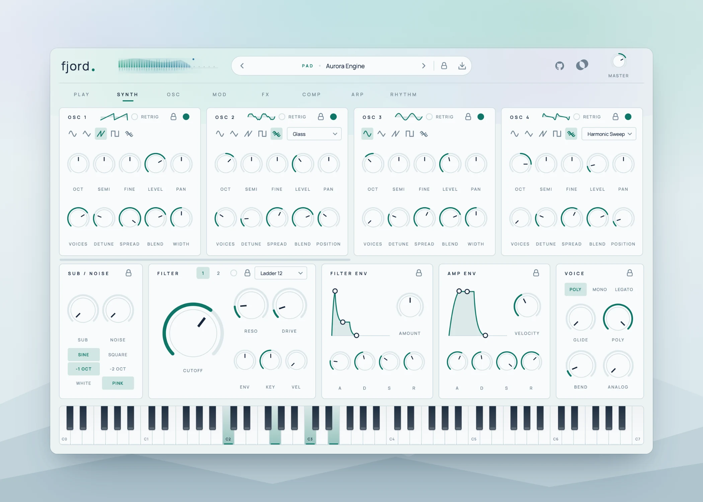
</picture>

### Osc
All eight oscillators at a glance, four across and two rows. With eight of them a single preset can hold a whole
chord on one key, an additive organ or bell built from harmonics, a choir section or a supersaw wall made of
independent layers. Every oscillator has its own padlock, and the modulation matrix reaches pitch, level,
wavetable position and width of each one.

<picture>
  <source media="(prefers-color-scheme: dark)" srcset="docs/screenshots/osc-dark.webp">
  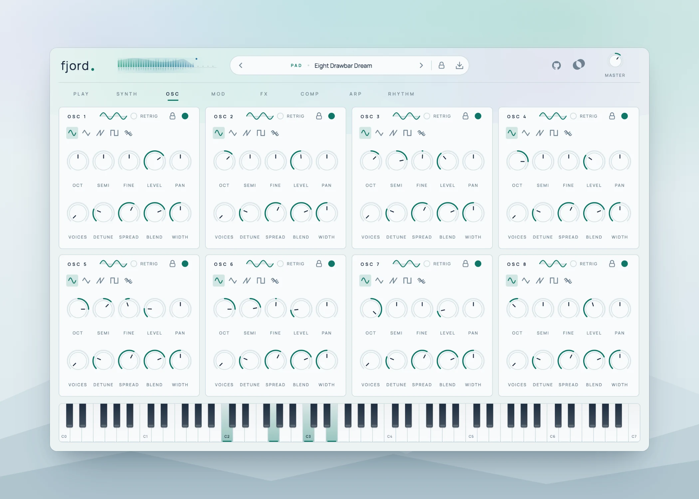
</picture>

### Play
The performance page. The output becomes a little fjord: northern lights that follow the waveform, mountain ridges
that rise with the lows, mids and highs, and water that mirrors it all (dawn in the light theme, night in the dark
one – click it for an oscilloscope or a spectrum). Next to it an **XY pad** controls any two macros (or cutoff,
resonance, glide, analog) at once; the dot glides after your mouse, leaves a trail and can **drift** on its own to
keep a held chord alive. Below: the eight macros and **snapshots** – store two macro settings, morph between them with
a slider, "Vary" for a happy accident, "Reset" back to the preset.

<picture>
  <source media="(prefers-color-scheme: dark)" srcset="docs/screenshots/play-dark.webp">
  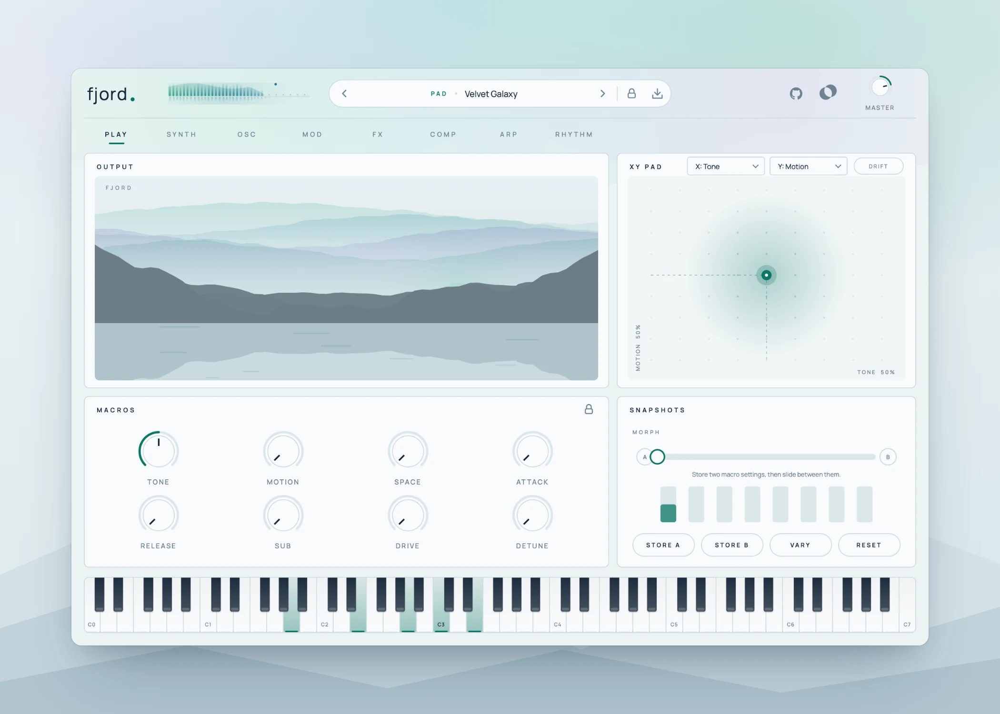
</picture>

### Mod
Three LFOs, a mod envelope and a 16-slot modulation matrix with via sources.

<picture>
  <source media="(prefers-color-scheme: dark)" srcset="docs/screenshots/mod-dark.webp">
  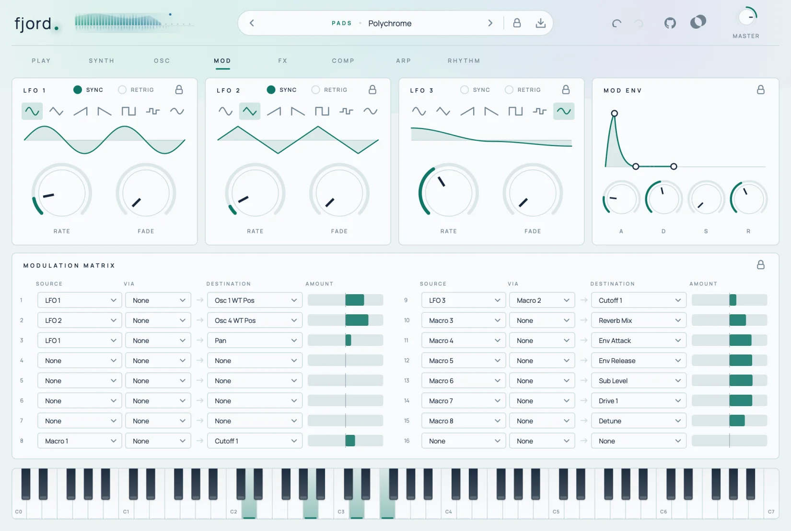
</picture>

### FX
Ten effects in a chain you reorder by drag & drop, with FX presets for the whole chain and "Lock FX".
Every effect also has its own preset menu in its title (20+ settings each – rooms, plates and halls for
the reverb, tape and tube for the drive, slapback to dub for the delay …), and you can save your own.
The EQ is fully parametric and is edited right in the graph: drag the six band points (frequency and gain,
Shift for fine moves), turn the mouse wheel for the Q of the peaks or the slope (12/24 dB) of the cuts,
double-click empty space to drop a peak there, double-click a point to reset it, right-click for a band menu.
The output spectrum runs in the background.

<picture>
  <source media="(prefers-color-scheme: dark)" srcset="docs/screenshots/fx-dark.webp">
  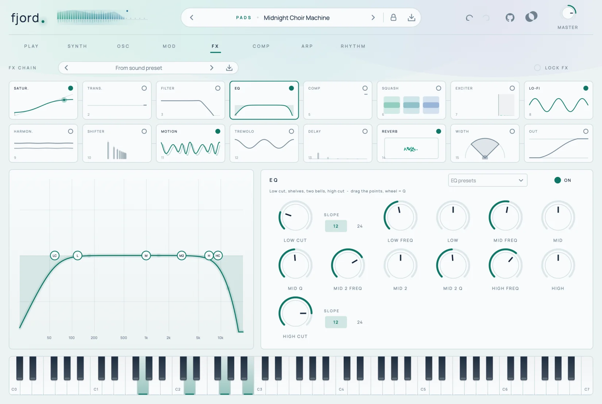
</picture>

### Comp
The compressor of the effect chain on its own page. Grab the **transfer curve**: drag the dot for the threshold,
drag the end of the curve for the ratio (mouse wheel: ratio, double-click: reset); a glowing dot rides on the curve
with the incoming level. The **dynamics view** scrolls through the last seconds – input, output and the gain
reduction hanging from the top – next to IN / GR / OUT meters. **One-click characters** (Gentle, Glue, Punch,
Squash, Parallel, Breathe) set everything at once; knee, a sidechain filter (the lows no longer pump the sound)
and auto gain are there for fine tuning.

<picture>
  <source media="(prefers-color-scheme: dark)" srcset="docs/screenshots/comp-dark.webp">
  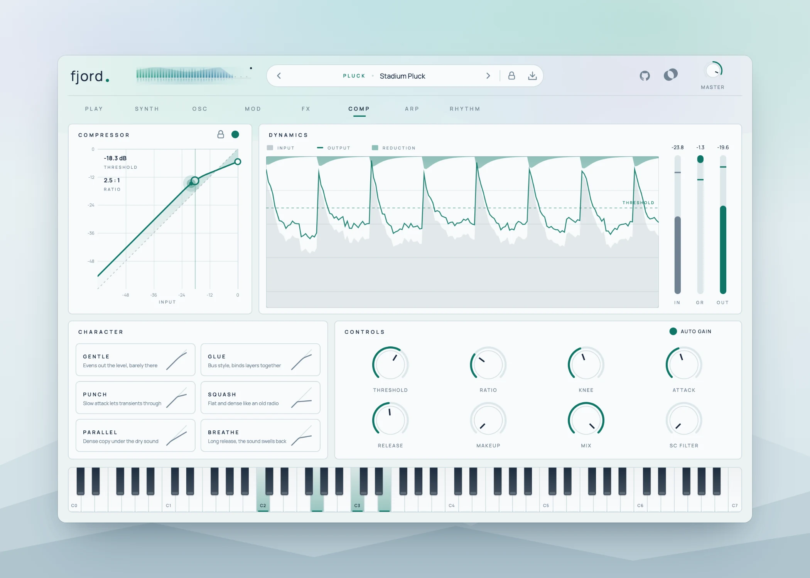
</picture>

### Arp
The arpeggiator has its own page: eleven modes (Up, Down, Up/Down, Down/Up, Converge, Diverge, Thumb, Pinky,
Random, Played, Chord), rate, octaves, gate, swing, note repeats, chance and retrigger – plus a 16-step pattern with
a velocity lane (draw to the bottom for a rest), a pitch lane (±12 semitones per step) and ties for legato
slides. Click a step number to set the pattern length (1–16, also odd lengths for polyrhythms), or pick one of the
pattern presets / "Randomize".

124 arp presets play their own melody from the pitch lane (`Melody` tag in the browser): hold a single key and
you hear the tune on that root, hold a chord and the tune walks through the chord notes as well – from pop hooks
and disco octaves to house stabs, lullabies and slow ambient calls.

<picture>
  <source media="(prefers-color-scheme: dark)" srcset="docs/screenshots/arp-dark.webp">
  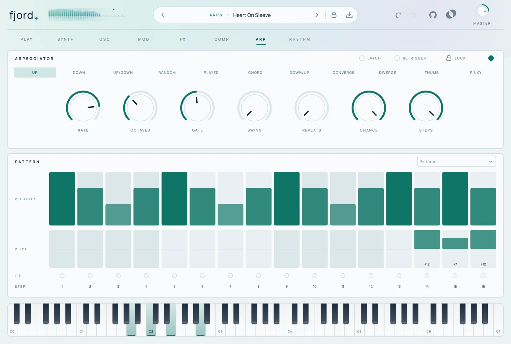
</picture>

### Rhythm
Step gate (shutter), stutter and sidechain pump – all synced to the song.

<picture>
  <source media="(prefers-color-scheme: dark)" srcset="docs/screenshots/rhythm-dark.webp">
  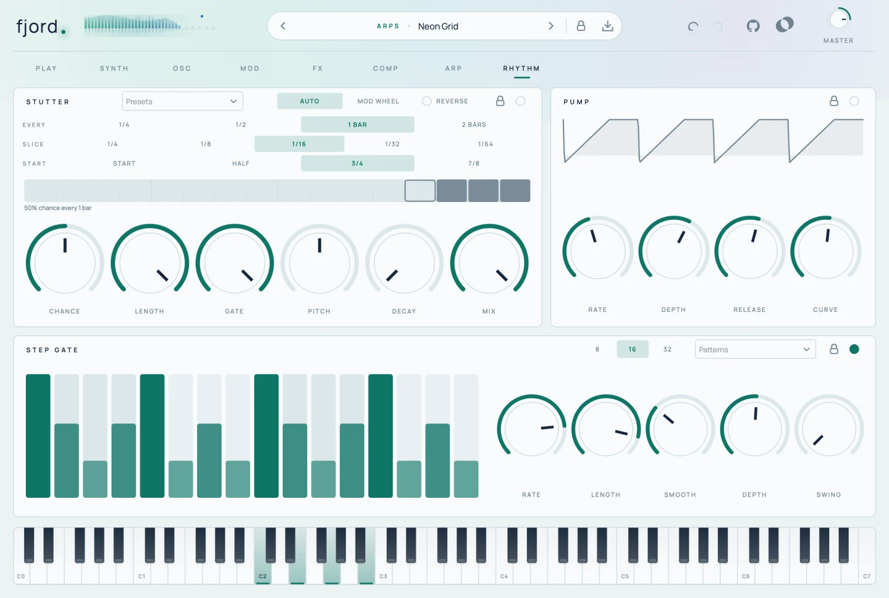
</picture>

### Presets
A browser with categories, favorites and your own presets. Every preset carries tags (Warm, Evolving, Pulsing,
Wide, Short, Chord, Disco …); click tag chips to combine filters, and the search looks through names, categories and tags
("warm pad", "glide bass").

<picture>
  <source media="(prefers-color-scheme: dark)" srcset="docs/screenshots/browser-dark.webp">
  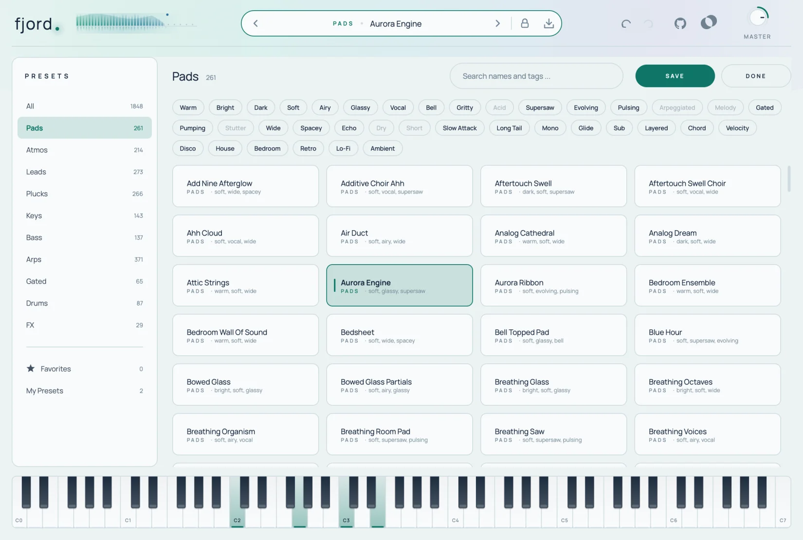
</picture>

### Header and About
Next to the logo, the output level rises as northern lights over the water: the left channel as rays above the
horizon, the right channel as their reflection, with a peak star on top (hover for the values in dB).
A click on the "fjord." logo opens the About panel – version, plugin format, host, plugin path, preset and settings
folders, sample rate, system – with "Copy debug info", which puts a full report (including every parameter that
differs from its default) on the clipboard for bug reports. "Show plugin" reveals the plugin file, "Stop notes" is the panic.

### Light and dark
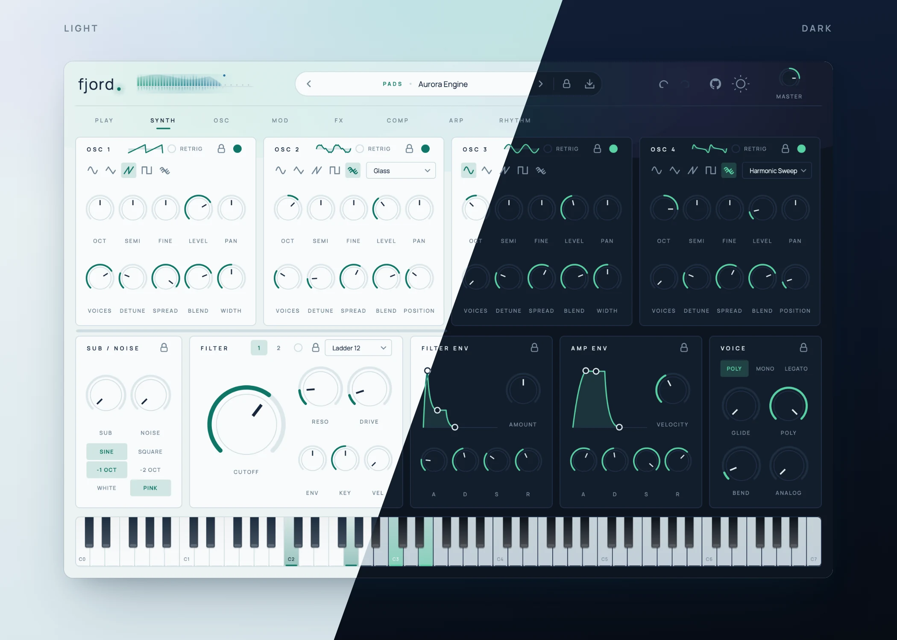

## Sound architecture

| Page | Contents |
|---|---|
| **Synth** | 8 oscillators (sine, triangle, saw, square, 24 wavetables; the row scrolls sideways past the first four), unison up to 8 voices, sub, noise, 2 filters (ladder, SVF, comb, formant; serial/parallel), filter/amp envelopes with draggable graphs, poly/mono/legato, glide, analog drift, key follow, amp curve |
| **Osc** | All 8 oscillators at a glance (4 × 2) – chords in one key, additive organs and bells, layered supersaw walls |
| **Mod** | 3 LFOs (tempo sync, retrigger, fade), mod envelope, 16-slot modulation matrix (source → destination, via) |
| **FX** | Drive, bitcrush, parametric EQ (low/high cut 12/24 dB, two shelves, two peaks, edited in the graph), compressor (knee, sidechain filter, auto gain), chorus, phaser, flanger, delay, reverb, width – reorder by drag & drop; FX presets |
| **Comp** | The compressor up close: transfer curve to drag (threshold, ratio), scrolling input/output/reduction history, IN/GR/OUT meters, knee, sidechain filter, auto gain and one-click characters (Gentle, Glue, Punch, Squash, Parallel, Breathe) |
| **Arp** | 11 modes, rate, octaves, gate, swing, repeats, chance, retrigger, latch; 16-step pattern with velocity, pitch and tie lanes, pattern presets |
| **Rhythm** | Step gate (8/16/32 steps, patterns), stutter (auto or mod wheel, with timeline and presets), sidechain pump – synced to the song |
| **Play** | 8 macros per preset (Tone, Motion, Space, Attack, Release, Vibrato, Drive, Detune), XY pad with drift, macro snapshots with morph, fjord visual / oscilloscope / spectrum |

Controls: double-click resets a knob, hovering over a knob shows its value.
The window can be resized from the bottom-right corner (75–150 %).
Clicking the "fjord." logo opens the About panel; double-clicking it stops all notes immediately (panic), e.g. after a lost note-off.

**Locks** – keep parts of a sound while you browse: the padlock in the preset bar locks single oscillators
(or all eight), sub + noise, the filters, the envelopes, the whole effect chain or single effects, the arpeggiator,
the step gate, the stutter and the pump. The oscillator, filter, effect and rhythm panels also have their own padlock.
Locked parts stay exactly as they are when you switch presets, so you can keep the arp pattern and the delay of one
sound and try them on many others.

## Presets

- Factory presets: `presets/Factory/<category>/*.fjord` (embedded in the plugin)
- User presets: `~/Music/Fjord/Presets` (Windows: `Documents\\Fjord\\Presets` – the user's music folder; save via the ⤓ icon or in the browser)
- Categories: Pad, Atmos, Lead, Pluck, Keys, Bass, Arp, Gated, Drums, FX
- Tags: every factory preset has tags for character, movement, space, shape and style; your own presets get the
  tags you type in the save dialog (prefilled with the tags of the preset you started from)
- FX presets (effect chain only): at the top of the FX page; user FX presets live in `~/Music/Fjord/FX Presets`.
- Effect module presets (one effect only, 216 factory presets): menu in each effect's title;
  your own live in `~/Music/Fjord/FX Module Presets/<effect>`.
  "Lock FX" keeps the effects when switching sound presets.

The factory presets are plain XML files in `presets/` (`Factory`, `FxFactory`, `FxModules`). They are embedded in the
plugin at build time, so adding or changing a file there and rebuilding is all it takes. Parameter IDs are listed by
`FjordRenderTest --params <file>`; parameters a preset leaves out use their default. `FjordRenderTest --loudness
<json>` measures how loud each preset is.

## Tests

```bash
./build/FjordRenderTest_artefacts/Release/FjordRenderTest build/renders              # all tests + UI screenshots
./build/FjordRenderTest_artefacts/Release/FjordRenderTest build/renders --sr 96000   # at another sample rate
./build/FjordRenderTest_artefacts/Release/FjordRenderTest --single "Pop Kick" 36 out.wav
```

`--loudness` measures every preset with a fresh plugin instance, so the result does not depend on the preset order.

The test renders every preset and every effect offline and checks for NaN, clipping, DC offset, silence and
stuck notes; it also checks the locks, FX presets, oversized/odd host block sizes and a full load with all eight
oscillators. Screenshots of both themes go to `build/renders/`; WAV files only with `FJORD_WAV=1`.

## Audio examples

The examples in [Listen](#listen) are made by a script, so they can be renewed whenever presets change:

```bash
cmake --build build --target FjordRenderTest
python3 tools/demos/make_demos.py          # all examples -> docs/audio/*.mp3 and docs/audio/video/*.mp4
python3 tools/demos/make_demos.py bass     # only one
```

The melodies are written in `tools/demos/make_demos.py`. `FjordRenderTest --demo <preset> <score.txt> <out.wav>`
plays a score (beats, MIDI notes, velocities) with a running host transport, ffmpeg mixes the layers and matches
the loudness. GitHub only plays media that was uploaded through its editor, so for inline players drag the files
from `docs/audio/video/` into the README on github.com; the links above work everywhere.

## Screenshots

The images in this README are made by a script, so they can be renewed after every UI change:

```bash
cmake --build build --target FjordRenderTest
cd tools/screenshots
npm install && npx playwright install chromium   # once
node shoot.mjs                                   # all images -> docs/screenshots/
node shoot.mjs hero synth                        # only some of them
```

1. `FjordRenderTest --screenshot <page> <preset> <light|dark> <out.png> [fx] [notes]` (page: play, synth, osc, mod, fx, comp, arp, rhythm, browser, about) renders the real plugin UI
   offscreen (with held notes on the keyboard) to `build/screenshots/raw/`.
2. `shoot.mjs` (Playwright) puts these shots on a backdrop – window frame, shadow, fjord silhouette, title –
   in a light and a dark version; the README shows the one matching the reader's GitHub theme.

Which page is shot with which preset is set in `tools/screenshots/shots.config.mjs`.

## Icon

The app icon (`resources/icon.png`) and the profile picture (`resources/profile.png`) are drawn by the notebook
`tools/icon/make_icon.ipynb` (numpy + Pillow): flat aurora ribbons over geometric mountains, mirrored in the water,
with the "f." mark in Manrope. Run all cells to rebuild both images, then `./build.sh` to embed the icon.

## Contributing

Issues and pull requests are welcome – see [CONTRIBUTING.md](CONTRIBUTING.md). Please follow the
[Code of Conduct](CODE_OF_CONDUCT.md); security issues go through [SECURITY.md](SECURITY.md).

## Licences

Fjord is free software under the **GNU Affero General Public License v3.0** ([LICENSE](LICENSE)).

- JUCE 8: AGPLv3 (used under its open source licence, downloaded at build time)
- Manrope font: SIL Open Font License 1.1 (`resources/fonts/OFL.txt`), embedded unmodified
- Playwright (screenshot tool only, not part of the plugin): Apache License 2.0

See [THIRD_PARTY_NOTICES.md](THIRD_PARTY_NOTICES.md) for details.
